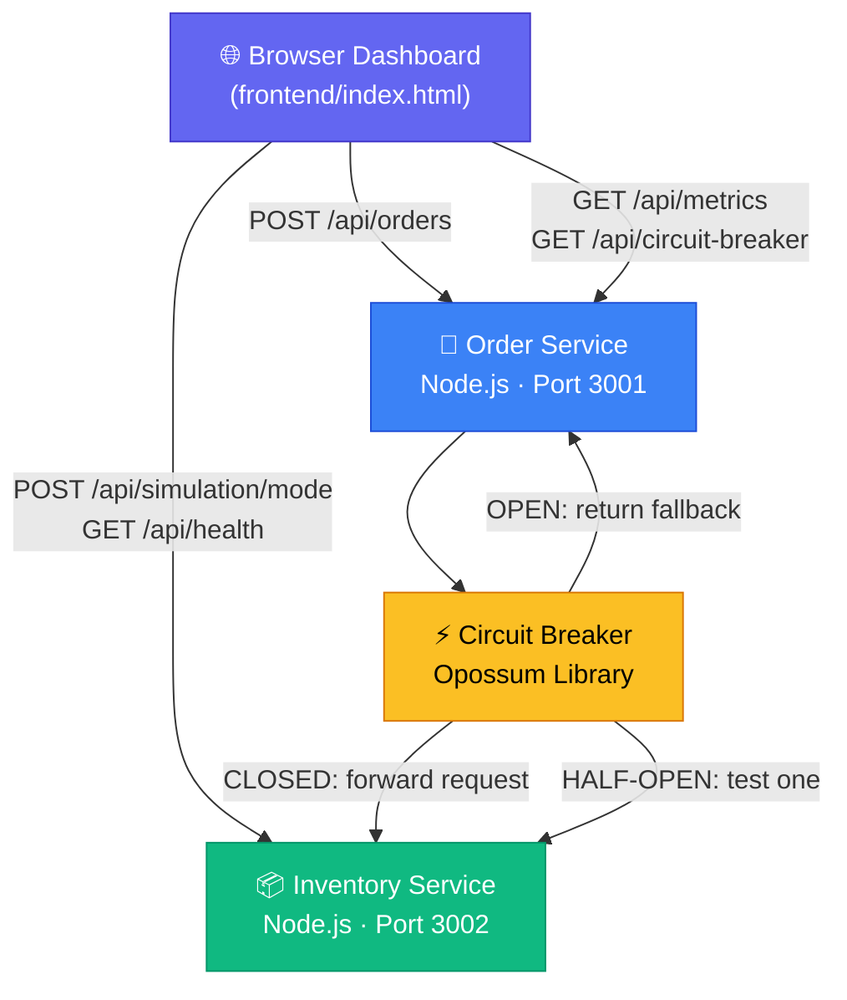

# ⚡ Microservices Resilience Lab
### Practical-9 — Resilience and Security Patterns in Microservices (Circuit Breaker Pattern)
**Subject:** Mobile Application Programming (MAP) | B.Tech Sem 7

---

## AIM

Implement resilience and security patterns in microservices, focusing on the **Circuit Breaker Pattern**. Configure circuit breakers to handle service failures gracefully, ensure robustness, and enhance the reliability of a microservices architecture.

---

## Problem Statement

In a microservices architecture, services frequently call each other over a network. When one service (e.g., the Inventory Service) becomes slow, unavailable, or returns errors, the caller (e.g., the Order Service) waits for responses that never arrive — causing **cascading failures**, wasted threads, and degraded user experience across the entire system.

**Problem:** Without a protection mechanism, a single failing service can bring down the entire application.

**Solution:** The **Circuit Breaker Pattern** acts as a proxy that monitors calls to a remote service. When failures reach a configured threshold, the breaker "opens" and immediately returns fallback responses instead of forwarding requests to the failing service — protecting the system from cascading failure.

---

## Objectives

1. Build two independent microservices (Order Service and Inventory Service) that communicate over HTTP.
2. Implement a real circuit breaker using the **Opossum** library.
3. Demonstrate all three circuit breaker states: CLOSED, OPEN, and HALF-OPEN.
4. Provide a live dashboard that visualises circuit breaker state, metrics, and events.
5. Demonstrate how fallback responses protect the calling service.
6. Apply security measures: Helmet headers, CORS, input validation, and rate limiting.

---

## Introduction to Microservices Resilience

Microservices architectures replace large monolithic applications with many small, independently deployable services. While this improves scalability and maintainability, it introduces **distributed system challenges**:

- **Latency:** Network calls are slower than in-process calls.
- **Partial failure:** Any service can fail at any time.
- **Cascading failure:** A failing downstream service can exhaust the connection pool of its callers, causing them to fail too.

**Resilience patterns** are design strategies that allow a system to gracefully handle failure. The Circuit Breaker is one of the most important resilience patterns.

---

## The Circuit Breaker Pattern

The Circuit Breaker Pattern, popularised by Michael Nygard (*Release It!*) and described in detail by Martin Fowler, wraps calls to a remote service with a **state machine** that tracks failures:

```
  Normal operation              Too many failures
  ┌─────────────┐              ┌──────────────────┐
  │   CLOSED    │──failures──▶ │      OPEN        │
  │  (passing)  │              │  (blocking all)  │
  └─────────────┘              └──────────────────┘
         ▲                             │
         │                     reset timeout expires
         │                             │
         │                             ▼
  test succeeds              ┌──────────────────┐
  ◀─────────────────────────│   HALF-OPEN      │
                             │  (testing one)   │
                             └──────────────────┘
                                       │
                               test fails → OPEN
```

### CLOSED State
- **Default state.** All requests pass through to the downstream service.
- The breaker counts failures and successes within a rolling time window.
- When the **failure percentage exceeds the threshold** (and a minimum volume has been reached), the breaker transitions to OPEN.

### OPEN State
- **Blocking state.** The breaker immediately returns a fallback response without forwarding any requests to the downstream service.
- This prevents wasted resources and gives the downstream service time to recover.
- After the configured **reset timeout**, the breaker transitions to HALF-OPEN.

### HALF-OPEN State
- **Testing state.** The breaker allows **one test request** through to the downstream service.
- If the test **succeeds**, the breaker transitions back to CLOSED (normal operation resumes).
- If the test **fails**, the breaker returns to OPEN and restarts the reset timeout.

---

## Architecture



### Request Flow

```
[Browser] ──POST /api/orders──▶ [Order Service :3001]
                                       │
                               [Opossum Circuit Breaker]
                                  │           │
                             CLOSED         OPEN
                                  │           │
                    GET /api/inventory/:id  Fallback JSON
                                  │
                        [Inventory Service :3002]
                                  │
                    200 OK / 500 Error / Timeout
```

---

## Technologies Used

| Technology | Purpose |
|---|---|
| **Node.js** | JavaScript runtime for microservices |
| **Express.js** | HTTP server framework |
| **Opossum** | Circuit breaker library for Node.js |
| **Axios** | HTTP client (Order Service → Inventory Service) |
| **Helmet** | Security HTTP headers |
| **CORS** | Cross-Origin Resource Sharing configuration |
| **express-rate-limit** | Basic API rate limiting |
| **dotenv** | Environment variable management |
| **HTML5 / CSS3 / Vanilla JS** | Frontend dashboard (no framework) |
| **Google Fonts (Inter)** | Typography |

---

## Project Structure

```
microservices-resilience-lab/
│
├── order-service/               # Microservice 1 — Port 3001
│   ├── server.js                # Express app entry point
│   ├── package.json
│   ├── .env                     # (generated from .env.example)
│   ├── .env.example             # Template with all env vars
│   ├── services/
│   │   └── circuitBreaker.js    # Opossum CB setup + metrics + events
│   ├── routes/
│   │   ├── orders.js            # POST /api/orders
│   │   ├── circuitBreakerRoutes.js  # GET/POST /api/circuit-breaker
│   │   └── metrics.js           # GET /api/metrics
│   └── middleware/
│       └── errorHandler.js      # Central error handler
│
├── inventory-service/           # Microservice 2 — Port 3002
│   ├── server.js                # Express app entry point
│   ├── package.json
│   ├── .env
│   ├── .env.example
│   ├── routes/
│   │   ├── inventory.js         # GET /api/inventory/:productId
│   │   └── simulation.js        # POST /api/simulation/mode
│   └── middleware/
│       └── errorHandler.js
│
├── frontend/                    # Dashboard (open index.html in browser)
│   ├── index.html               # Dashboard HTML
│   ├── styles.css               # Styles
│   └── app.js                   # Dashboard JavaScript
│
├── README.md
└── .gitignore
```

---

## Installation and Setup

### Prerequisites
- **Node.js** v18 or later — [nodejs.org](https://nodejs.org)
- **npm** v9 or later (bundled with Node.js)
- Two open terminal windows in VS Code

### Step 1 — Clone / Navigate to the project

```powershell
cd "d:\B.Tech 1st year\Sem-7\MAP\Practical-9.2\microservices-resilience-lab"
```

### Step 2 — Install dependencies

Open **Terminal 1** and run:

```powershell
cd order-service
npm install
```

Open **Terminal 2** and run:

```powershell
cd inventory-service
npm install
```

### Step 3 — Create environment files (already done if you used the setup)

```powershell
# In order-service directory
Copy-Item .env.example .env

# In inventory-service directory
Copy-Item .env.example .env
```

---

## Environment Variable Configuration

### Order Service (`order-service/.env`)

| Variable | Default | Description |
|---|---|---|
| `PORT` | `3001` | Port for Order Service |
| `INVENTORY_SERVICE_URL` | `http://localhost:3002` | URL to reach Inventory Service |
| `CB_TIMEOUT` | `3000` | Circuit breaker timeout (ms) |
| `CB_ERROR_THRESHOLD_PERCENTAGE` | `50` | Failure % to open breaker |
| `CB_RESET_TIMEOUT` | `10000` | Time before HALF-OPEN (ms) |
| `CB_VOLUME_THRESHOLD` | `3` | Min requests before CB can open |
| `ALLOWED_ORIGINS` | `http://localhost:5500,...` | CORS allowed origins |

### Inventory Service (`inventory-service/.env`)

| Variable | Default | Description |
|---|---|---|
| `PORT` | `3002` | Port for Inventory Service |
| `SLOW_MODE_DELAY` | `5000` | Delay in slow mode (ms) — should exceed `CB_TIMEOUT` |
| `DEFAULT_SIMULATION_MODE` | `normal` | Starting simulation mode |

---

## Running the Application

You need **three terminal windows**:

### Terminal 1 — Start Inventory Service

```powershell
cd "d:\B.Tech 1st year\Sem-7\MAP\Practical-9.2\microservices-resilience-lab\inventory-service"
npm start
```

Expected output:
```
───────────────────────────────────────────────────────
  📦  Inventory Service running on http://localhost:3002
  🎭  Simulation Mode : normal
  🐢  Slow Mode Delay : 5000ms
───────────────────────────────────────────────────────
```

### Terminal 2 — Start Order Service

```powershell
cd "d:\B.Tech 1st year\Sem-7\MAP\Practical-9.2\microservices-resilience-lab\order-service"
npm start
```

Expected output:
```
───────────────────────────────────────────────────────
  🚀  Order Service running on http://localhost:3001
  📦  Inventory URL : http://localhost:3002
  ⚡  CB Timeout    : 3000ms
  📊  CB Threshold  : 50%
  🔄  CB Reset In   : 10000ms
───────────────────────────────────────────────────────
```

### Terminal 3 — Open the Dashboard

Open `frontend/index.html` directly in your browser:

```powershell
# Option A: Open with VS Code Live Server (recommended)
# Right-click index.html in VS Code Explorer → "Open with Live Server"

# Option B: Open directly
Start-Process "d:\B.Tech 1st year\Sem-7\MAP\Practical-9.2\microservices-resilience-lab\frontend\index.html"
```

> **Dashboard URL:** `http://127.0.0.1:5500/frontend/index.html` (Live Server) or open the file directly.

---

## API Endpoints

### Order Service (Port 3001)

#### `POST /api/orders` — Place an order

**Request:**
```json
{
  "productId": "P001",
  "quantity": 2
}
```

**Success Response (201):**
```json
{
  "success": true,
  "fallback": false,
  "message": "Order placed successfully.",
  "order": {
    "orderId": "ORD-1792817161435-4974",
    "productId": "P001",
    "productName": "Wireless Keyboard",
    "quantity": 2,
    "status": "CONFIRMED",
    "placedAt": "2026-10-24T04:46:01.435Z"
  },
  "circuitBreakerState": "CLOSED"
}
```

**Fallback Response (503 — CB OPEN):**
```json
{
  "success": false,
  "fallback": true,
  "message": "Order cannot be confirmed — the circuit breaker is OPEN.",
  "circuitBreakerState": "OPEN",
  "retryable": true,
  "hint": "The circuit breaker will attempt recovery in ~10s."
}
```

#### `GET /api/circuit-breaker` — CB state and config

#### `POST /api/circuit-breaker/reset` — Force-reset to CLOSED (demo only)

#### `GET /api/metrics` — Full metrics with event log

#### `POST /api/metrics/reset` — Reset demo counters

#### `GET /api/health` — Service health check

### Inventory Service (Port 3002)

#### `GET /api/inventory/:productId?quantity=1` — Check inventory

**Valid Product IDs:** P001, P002, P003, P004, P005

**Success Response (200):**
```json
{
  "success": true,
  "productId": "P001",
  "productName": "Wireless Keyboard",
  "stock": 150,
  "requestedQuantity": 2,
  "available": true,
  "price": 45.99,
  "simulationMode": "normal",
  "timestamp": "2026-10-24T04:46:01.432Z"
}
```

#### `GET /api/health` — Health check

#### `GET /api/stats` — Request counters (useful for verifying CB behaviour)

#### `GET /api/simulation/mode` — Get current simulation mode

#### `POST /api/simulation/mode` — Change simulation mode

**Request:**
```json
{ "mode": "failure" }
```

**Valid modes:** `normal`, `failure`, `slow`, `recovery`

---

## Practical Demonstration Scenarios

### ✅ Scenario 1: Normal Operation

**Steps:**
1. Start both services, open the dashboard.
2. Verify both service status cards show **● UP**.
3. Verify Circuit Breaker shows **🟢 CLOSED**.
4. Select any product, enter quantity 1.
5. Click **Place Order**.

**Expected observations:**
- Response box shows green success with an `orderId`.
- Inventory Service logs: `P001 — stock=150, requested=1, available=true`.
- CB stats: `fires=1, successes=1`.
- `inventoryRequests` counter increments.
- Event log shows: `ORDER_RECEIVED` → `SUCCESS` → `ORDER_CONFIRMED`.

---

### ❌ Scenario 2: Service Failure → Circuit Opens

**Steps:**
1. Click **❌ Failure** button in the Fault Simulation panel.
2. Confirm the mode badge changes to `failure`.
3. Click **Place Order** several times (at least 3–4 times quickly).
4. Watch the Circuit Breaker card — it will change to **🔴 OPEN**.
5. Continue placing orders while the breaker is OPEN.

**Expected observations:**
- First 2-3 requests: Inventory Service returns 500, fallback returned (CB still CLOSED).
- After threshold: CB opens — `circuitBreakerState: "OPEN"` in response.
- Subsequent requests: **Immediate** fallback without hitting Inventory Service.
- `inventoryRequests` counter **stops increasing** once breaker is OPEN (blocked requests never reach Inventory Service).
- Event log shows: `FAILURE` events → `STATE_CHANGE: OPEN` → `REJECTED` events.

> **Key insight for viva:** The `inventoryRequests` counter stays the same while the CB is OPEN — proving that Opossum is truly blocking calls, not just returning a label.

---

### 🐢 Scenario 3: Timeout

**Steps:**
1. First click **📊 Reset Metrics** and **🔧 Reset Circuit Breaker** to start fresh.
2. Click **🐢 Slow** in the Fault Simulation panel.
3. Place 3–4 orders in quick succession.

**Expected observations:**
- Each order waits ~3 seconds (CB timeout), then receives a fallback response.
- `timeouts` counter increments in the metrics panel.
- Event log shows `TIMEOUT` events.
- Timeouts count as failures — after enough timeouts, the CB will open.
- Once CB opens, further orders receive immediate fallback (no 3-second wait).

---

### 🔄 Scenario 4: Service Recovery → HALF-OPEN → CLOSED

**Steps:**
1. (Start with CB in OPEN state from Scenario 2.)
2. Click **✅ Normal** to restore normal Inventory Service operation.
3. Wait approximately **10 seconds** (the `CB_RESET_TIMEOUT`).
4. Watch the Circuit Breaker card — it will change to **🟡 HALF-OPEN**.
5. Place one order.

**Expected observations (if test succeeds):**
- The single order reaches the (now-recovered) Inventory Service.
- Response is a successful order confirmation.
- CB immediately transitions from HALF-OPEN to **🟢 CLOSED**.
- Event log shows: `STATE_CHANGE: HALF_OPEN` → `SUCCESS` → `STATE_CHANGE: CLOSED`.

**If the Inventory Service is still failing during the half-open test:**
- CB returns to **🔴 OPEN** and restarts the 10-second timer.

---

## Security Measures

| Measure | Implementation |
|---|---|
| **Helmet** | Adds 11 security HTTP headers (CSP, HSTS, X-Frame-Options, etc.) |
| **CORS** | Only explicitly listed origins can call each service |
| **Input Validation** | Product IDs and quantities are validated before processing |
| **Simulation Mode Validation** | Only known modes (`normal`, `failure`, `slow`, `recovery`) are accepted |
| **Rate Limiting** | 100 req/min on Order Service, 200 req/min on Inventory Service |
| **Body Size Limit** | JSON bodies capped at 16KB |
| **Error Handling** | Stack traces never exposed to clients; internal errors logged server-side |
| **No Secret Leakage** | `.env` files excluded from version control via `.gitignore` |
| **Timeouts** | Axios client timeout + CB timeout prevent hanging connections |

> **Limitation:** These are educational-grade measures. Production systems require authentication tokens, TLS/HTTPS, secrets management (Vault/AWS Secrets Manager), and thorough penetration testing.

---

## Advantages and Limitations

### Advantages
- **Prevents cascading failure:** A failing Inventory Service cannot take down the Order Service.
- **Fast fallback:** Clients receive immediate responses instead of waiting for timeouts.
- **Automatic recovery:** Half-open state allows the system to self-heal without manual intervention.
- **Visibility:** Real-time metrics show exactly what the circuit breaker is doing.
- **Configurable:** All thresholds are environment variables — easy to tune.

### Limitations
- **In-memory state:** Circuit breaker state is per-instance. In a real cluster, a distributed store (Redis) is needed.
- **Fallback orders not fulfilled:** When the breaker is OPEN, orders are not queued for retry — they are simply rejected.
- **No authentication:** The simulation endpoints and order endpoint have no user authentication.
- **Single-host:** This setup runs on one machine; a real microservices deployment uses orchestration (Kubernetes) and service meshes (Istio/Linkerd).

---

## Conclusion

This practical successfully demonstrates the Circuit Breaker Pattern using Opossum in a Node.js microservices architecture. The project shows:

1. How a circuit breaker protects the Order Service from the Inventory Service's failures.
2. All three states (CLOSED → OPEN → HALF-OPEN → CLOSED) with real state transitions driven by Opossum.
3. How the `inventoryRequests` counter proves that blocked calls never reach the failing service.
4. How a fallback mechanism provides graceful degradation instead of cascading failure.
5. Basic security practices appropriate for a microservices educational project.

The Circuit Breaker Pattern is an essential building block of any resilient microservices architecture, and libraries like Opossum make it straightforward to implement in Node.js.

---

## Troubleshooting

| Problem | Solution |
|---|---|
| `EADDRINUSE: address already in use :::3001` | Another process is using port 3001. Run: `netstat -ano \| findstr :3001` then kill the process. |
| Dashboard shows both services as DOWN | Ensure both `npm start` commands are running in separate terminals. |
| Circuit breaker never opens | You need at least `CB_VOLUME_THRESHOLD` (default: 3) failures. Send more requests. |
| CORS error in browser console | Open the HTML via Live Server (`http://127.0.0.1:5500`), not via `file://`. |
| Inventory counter keeps increasing even when CB is OPEN | Check `inventoryRequests` in metrics — only calls that actually reach the service are counted. |
| Order Service can't reach Inventory Service | Verify Inventory Service is running on port 3002. Check `INVENTORY_SERVICE_URL` in `order-service/.env`. |
| `npm install` fails | Ensure Node.js ≥ 18 is installed. Run `node --version` to check. |

---

## Commands Quick Reference

```powershell
# Terminal 1 — Inventory Service
cd inventory-service && npm start

# Terminal 2 — Order Service  
cd order-service && npm start

# Open dashboard (VS Code Live Server recommended)
# Right-click frontend/index.html → Open with Live Server

# API test — place order (PowerShell)
Invoke-RestMethod -Uri "http://localhost:3001/api/orders" `
  -Method Post `
  -Body '{"productId":"P001","quantity":1}' `
  -ContentType "application/json"

# API test — check circuit breaker
Invoke-RestMethod -Uri "http://localhost:3001/api/circuit-breaker"

# API test — enable failure mode
Invoke-RestMethod -Uri "http://localhost:3002/api/simulation/mode" `
  -Method Post `
  -Body '{"mode":"failure"}' `
  -ContentType "application/json"

# API test — restore normal
Invoke-RestMethod -Uri "http://localhost:3002/api/simulation/mode" `
  -Method Post `
  -Body '{"mode":"normal"}' `
  -ContentType "application/json"
```
